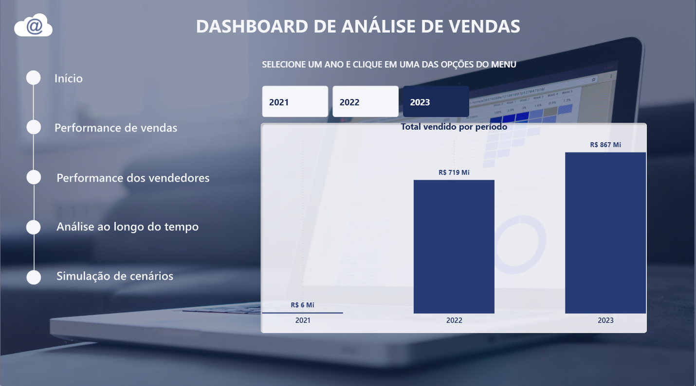
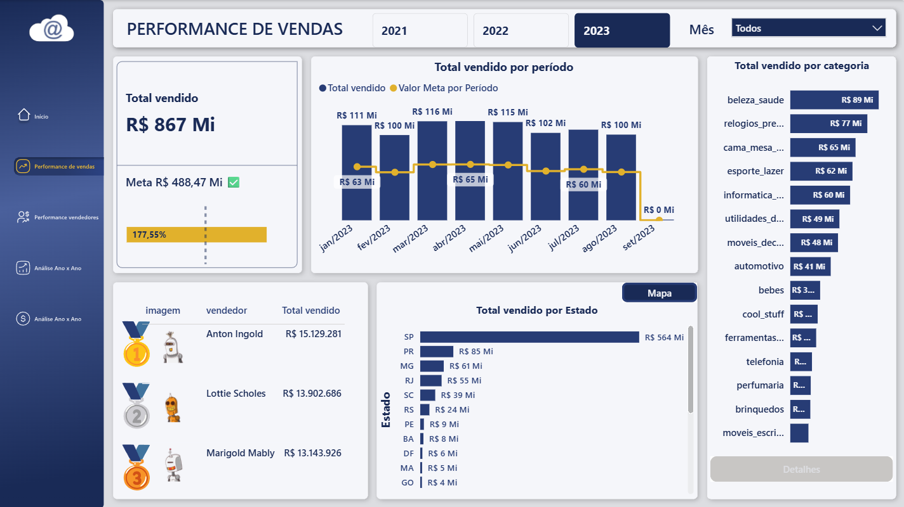
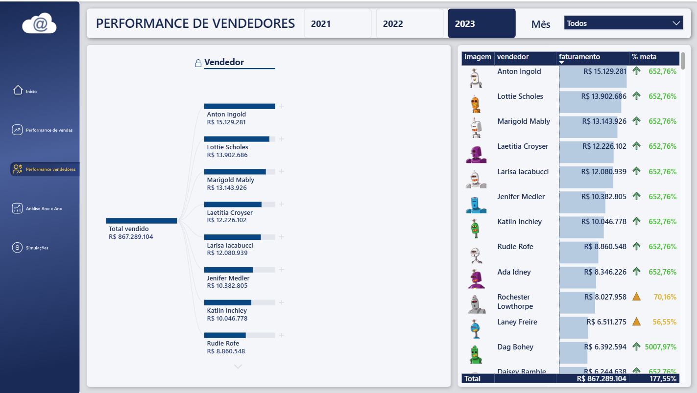
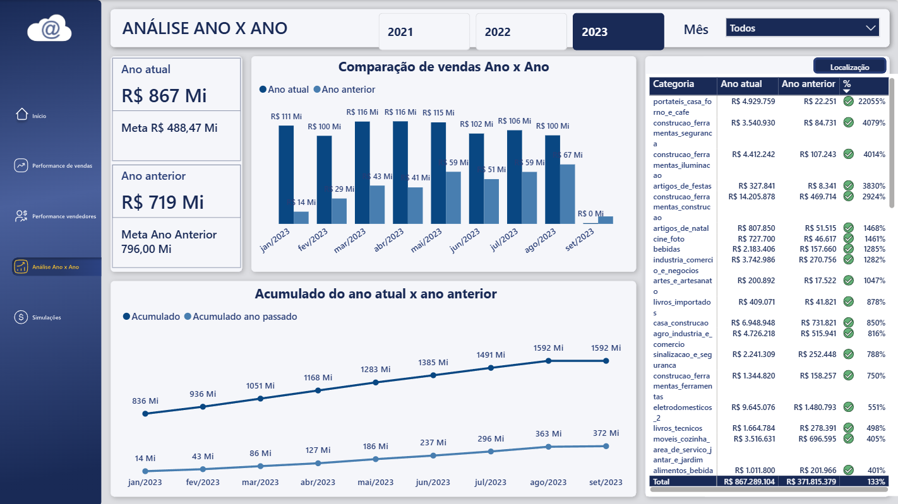
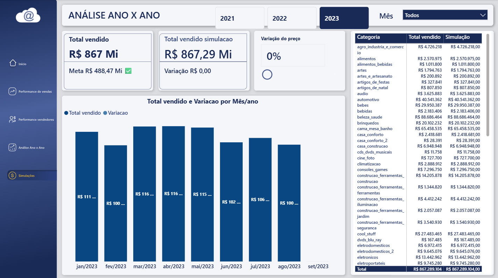
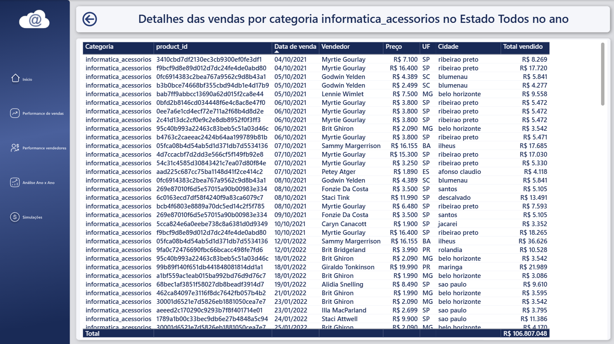

# Dashboard de Análise de Vendas | Power BI

Dashboard de vendas de 2021 a 2023 com acompanhamento de meta, ranking de vendedores, comparação com o ano anterior e simulação de preço.

**Arquivo:** [`Analise de Vendas.pbix`](Analise%20de%20Vendas.pbix) (abre no Power BI Desktop)

## Resumo

| Item | Detalhe |
| --- | --- |
| Período | 2021 a 2023 |
| Páginas | Início, Performance de vendas, Performance dos vendedores, Ano x Ano, Simulações |
| Páginas auxiliares | Detalhes (drill-through) e tooltip |
| Filtros | Ano (botões) e mês (lista) |
| Faturamento | 2021: R$ 6 Mi / 2022: R$ 719 Mi / 2023: R$ 867 Mi |
| Meta 2023 | R$ 488,47 Mi (atingimento de 177,55%) |

## Páginas

### 1. Performance de vendas

- Total vendido, meta e % de atingimento
- Venda mensal contra a meta de cada mês
- Top 3 vendedores
- Vendas por estado (botão **Mapa** alterna para o mapa) e por categoria
- Botão **Detalhes** abre a página de drill-through

### 2. Performance dos vendedores

- Árvore de decomposição: total, depois vendedor, depois categoria
- Tabela com faturamento e % da meta (seta verde: bateu a meta; triângulo amarelo: abaixo)
- Tooltip: ao passar o mouse no vendedor aparece o total, a meta e o velocímetro de atingimento

### 3. Análise Ano x Ano

- Total e meta do ano atual e do anterior
- Colunas mês a mês e linha de acumulado
- Tabela de variação % (botão alterna entre **categoria** e **localização**)

### 4. Simulações

- Segmentador de variação de preço
- Total vendido real, total simulado e diferença em R$
- Gráfico mensal e tabela por categoria

### 5. Detalhes (drill-through)

- Lista cada venda: categoria, produto, data, vendedor, preço, UF, cidade e total
- Recebe a categoria e o estado selecionados na página anterior

## Modelo de dados

Modelo estrela, com `fVendas` como tabela de fatos.

| Tabela | Conteúdo |
| --- | --- |
| `fVendas` | Data e preço das vendas |
| `dCalendario` | Ano, mês, mês/ano |
| `dProdutos` | Produtos e categorias |
| `dVendedores` | Nome, avatar, cidade e estado |
| `variacao_preco` | Parâmetro da simulação |
| `Medidas` | Medidas DAX |

**Principais medidas:** Total vendido, Total Meta, % Atingimento da meta, Total do ano anterior, Variação ano a ano, Acumulado, Ranking de vendedores, Total vendido simulação.

## Recursos utilizados

- Navegador de páginas
- Bookmarks (Barras/Mapa e Categoria/Localização)
- Drill-through
- Tooltip em página personalizada
- Árvore de decomposição
- Medidas DAX (meta, ano anterior, acumulado, simulação)
- Formatação condicional

## Como abrir

1. Baixe o `Analise_de_Vendas.pbix`
2. Abra no Power BI Desktop (gratuito, Windows)
3. Use os botões de ano, o filtro de mês e o menu lateral

## Autor

**Rhyan Carvalho** | [LinkedIn](https://www.linkedin.com/in/rhycarvalho) | [GitHub](https://github.com/rhycarvalho)
